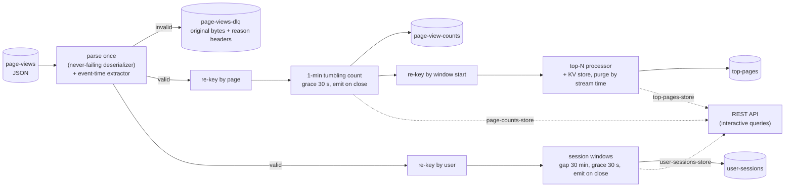

# clickstream-analytics-kafka-streams

[](https://github.com/rahulkumar96t/clickstream-analytics-kafka-streams/actions/workflows/ci.yml)

Real-time clickstream analytics on Apache Kafka Streams 4.4 (Java 21). JSON page-view events
come in; out come per-page counts in one-minute tumbling windows that tolerate late events, user
sessions based on 30 minutes of inactivity (length, page count, entry and exit page), the top-N
pages of every window, and a dead-letter topic for malformed records. A small REST API serves
the state stores through interactive queries. The topology is tested end to end with
`TopologyTestDriver`, so the test suite needs no broker; a Docker Compose file with a KRaft-mode
Kafka and a load generator are included for running it for real.

## Features

- **Event-time windowing**: 1-minute tumbling counts per page with a 30-second grace period for
  late and out-of-order events; each window is emitted **once, when it closes**
  (`EmitStrategy.onWindowClose()`).
- **Sessionization**: session windows with a 30-minute inactivity gap per user; emits session
  start/end, duration, page views, entry and exit page; late events can merge sessions.
- **Top-N pages per window**, ranked by count with a deterministic tie-break, computed by a
  Processor API stage over the final counts and kept in a bounded state store.
- **Dead-letter topic**: malformed JSON, wrong types and missing fields never crash the stream
  thread; the original key, value and headers go to `page-views-dlq` with the reason, source
  topic, partition and offset in headers.
- **Interactive queries**: REST endpoints over the window, session and key-value stores, showing
  live (not yet final) values too.
- **Runs for real**: Docker Compose with Apache Kafka in KRaft mode, exactly-once processing
  (`exactly_once_v2`) by default, topic bootstrap, and a load generator producing realistic
  traffic with configurable late and malformed shares.

## Architecture



| Package | Contents |
| --- | --- |
| `topology` | `ClickstreamTopology`, timestamp extractor, dead-letter and top-N processors, config |
| `serde` | Jackson mapper/serdes, `PageViewParser` (validation) |
| `model` | `PageView`, `PageCount`, `SessionStats`, `UserSession`, `TopPages` records |
| `api` | `QueryService` (store queries) and `QueryServer` (JDK `HttpServer`) |
| root | `ClickstreamApp` (main), `LoadGenerator` (main), `AppSettings` |

## Event format and outputs

Input (`page-views`, key = user id, optional):

```json
{"userId": "user-17", "page": "/products/42", "timestamp": "2026-01-01T10:00:05Z",
 "eventId": "optional", "referrer": "optional"}
```

`timestamp` is epoch milliseconds or an ISO-8601 instant and is the event time used for all
windows. Unknown fields are ignored.

| Topic | Key | Value (JSON, times in epoch ms) |
| --- | --- | --- |
| `page-view-counts` | page | `{"page":"/home","windowStart":1767261600000,"windowEnd":1767261660000,"count":2}` |
| `top-pages` | window start, ISO-8601 | `{"windowStart":...,"windowEnd":...,"pages":[{"page":"/home",...,"count":5}, ...]}` |
| `user-sessions` | user id | `{"userId":"alice","sessionStart":...,"sessionEnd":...,"durationMs":1500000,"pageViews":3,"entryPage":"/home","exitPage":"/cart"}` |
| `page-views-dlq` | original key | original bytes; headers `dlq.error.reason`, `dlq.source.topic`, `dlq.source.partition`, `dlq.source.offset` |

## Quickstart

The tests need only a JDK (21+):

```bash
./mvnw verify
```

Running against a real broker (requires Docker):

```bash
docker compose up -d                         # Kafka 4.4 in KRaft mode on localhost:9092
./mvnw -q package -DskipTests                # target/clickstream-analytics.jar + target/lib/

# Short windows make results show up quickly in a demo.
COUNT_WINDOW=PT1M LATENESS=PT10S SESSION_GAP=PT1M java -jar target/clickstream-analytics.jar

# In another terminal: 50 events/s from 200 users, 5% late, 2% malformed.
RATE=50 USER_IDLE=PT2M java -cp target/clickstream-analytics.jar \
  io.github.rahulkumar96t.clickstream.LoadGenerator
```

The application creates its input and output topics if they are missing. Settings come from
environment variables (`BOOTSTRAP_SERVERS`, `APPLICATION_ID`, `STATE_DIR`, `HTTP_PORT`,
`PARTITIONS`, `REPLICATION`, `PROCESSING`, `COUNT_WINDOW`, `LATENESS`, `SESSION_GAP`, `TOP_N`);
see `AppSettings` and `LoadGenerator` for defaults.

### REST API

```bash
curl 'localhost:8080/api/page-counts?page=/home'                    # per window, incl. open ones
curl 'localhost:8080/api/page-counts?from=2026-01-01T10:00:00Z&to=2026-01-01T10:05:00Z'
curl 'localhost:8080/api/top-pages?limit=5'                         # latest rankings
curl 'localhost:8080/api/top-pages?window=2026-01-01T10:00:00Z'
curl 'localhost:8080/api/users/user-17/sessions'
curl 'localhost:8080/health'
```

Times are ISO-8601 or epoch milliseconds; `from`/`to` bound window start times. A store that is
not queryable yet (startup, rebalance) answers `503`.

## Design decisions and trade-offs

- **Parse once, never fail in the deserializer.** The source serde turns every record into
  `Valid(PageView)` or `Invalid(rawBytes, reason)`. Because a `TimestampExtractor` receives the
  already-deserialized record, the extractor reads the event time from the parsed value, so JSON
  is parsed exactly once. Invalid records keep their broker timestamp, so they are never dropped
  for a bad timestamp before reaching the DLQ.
- **DLQ inside the topology** rather than in a deserialization exception handler: the routing
  is an ordinary branch, so it is covered by exactly-once processing and by `TopologyTestDriver`
  tests. (Kafka Streams 4.x also offers `errors.dead.letter.queue.topic.name` for exception
  handlers; this project validates content, not just bytes, so a branch fits better.) The DLQ
  keeps the original bytes and headers so records can be inspected and replayed.
- **Emit on window close instead of `suppress()`.** Downstream topics carry one final value per
  window/session, which keeps the top-N stage free of retractions: it only ever inserts final
  counts. The state stores still hold live values, which the REST API exposes. The price is
  latency: a window's count appears `window + grace` after it starts, a session `gap + grace`
  after its last event.
- **Top-N with the Processor API.** Counts are re-keyed by window start so a whole window meets
  in one task; a key-value store holds one ranking per window, updates are idempotent (a repeated
  count replaces itself), and a stream-time punctuator purges windows past their retention so
  the store stays bounded. A DSL `groupBy(...).aggregate(...)` would keep every window forever.
- **Late session merges.** Kafka Streams accepts a late event if the session it would join is
  still open, even when that bridges a session whose final result was already emitted. A test
  pins this down: the merged session is emitted again with the same user and start time, so
  consumers of `user-sessions` should upsert by `(userId, sessionStart)`.
- **Repartitioning.** Page counts and sessions need different keys (page vs user), so both
  branches repartition; the top-N stage repartitions a third time by window.
- **Stream time is per partition.** Windows close when *that partition* sees newer events; on a
  quiet partition final results wait for traffic. Production deployments usually accept this or
  add heartbeat events.
- **Test configuration.** On-close emission is throttled to once per second of wall-clock time
  by an internal setting (`__emit.interval.ms.kstreams.windowed.aggregation__`); the test harness
  sets it to 0 because the driver's wall clock does not move.

## Testing

`./mvnw verify` runs 44 tests (JUnit 6, AssertJ, `kafka-streams-test-utils`) and a
google-java-format check. No broker, Docker or network is needed: the topology runs in
`TopologyTestDriver`, and the REST test binds an ephemeral loopback port.

- **Tumbling windows** (`PageCountWindowTest`): window boundaries to the millisecond, emission
  exactly when stream time reaches window end + grace, late events inside the grace period
  counted, events after it dropped (asserted via the `dropped-records-total` metric) and never
  re-emitted, out-of-order events inside a window, live counts in the store before close.
- **Sessions** (`SessionizationTest`): one session within the gap, a new one after it, an
  out-of-order event bridging two open sessions, the late-merge re-emission described above,
  per-user isolation and querying open sessions.
- **Top-N** (`TopPagesTest`): ranking, tie-break, truncation to N, one ranking per closed window,
  idempotence.
- **Dead letters** (`DeadLetterTest`): 11 kinds of malformed input, null values, header
  propagation, and valid traffic flowing undisturbed around bad records.
- **REST API** (`QueryServerTest`): every endpoint against the driver's stores, 400/404/405 and
  503 handling.
- Model, parser, settings and load-generator unit tests.

As a sanity check during development, switching the count to `onWindowUpdate()` or setting the
grace period to zero each made several of these tests fail.

## Limitations and roadmap

- **The Docker/real-broker path has not been run in this repository's verification**: CI and
  the local test run cover the topology through `TopologyTestDriver` only. The packaged app was
  started without a broker to check that it launches; everything after connecting to Kafka is
  untested here.
- Interactive queries are local to one instance. `application.server` is set, but there is no
  forwarding to the instance that owns a key (`KafkaStreams.queryMetadataForKey`) yet, so with
  several instances each serves only its own partitions.
- Events with timestamps far in the future (bad client clocks) advance stream time and can close
  windows early; a guard against excessive clock skew would belong in the parser.
- JSON without a schema registry; Avro or Protobuf with schema evolution would be the next step.
